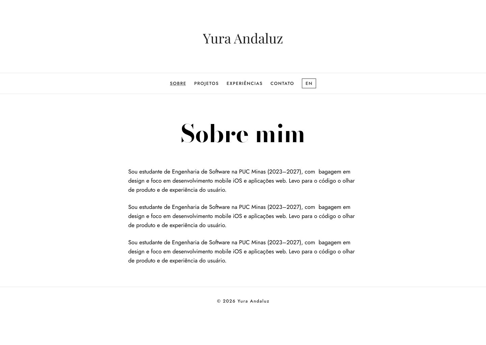
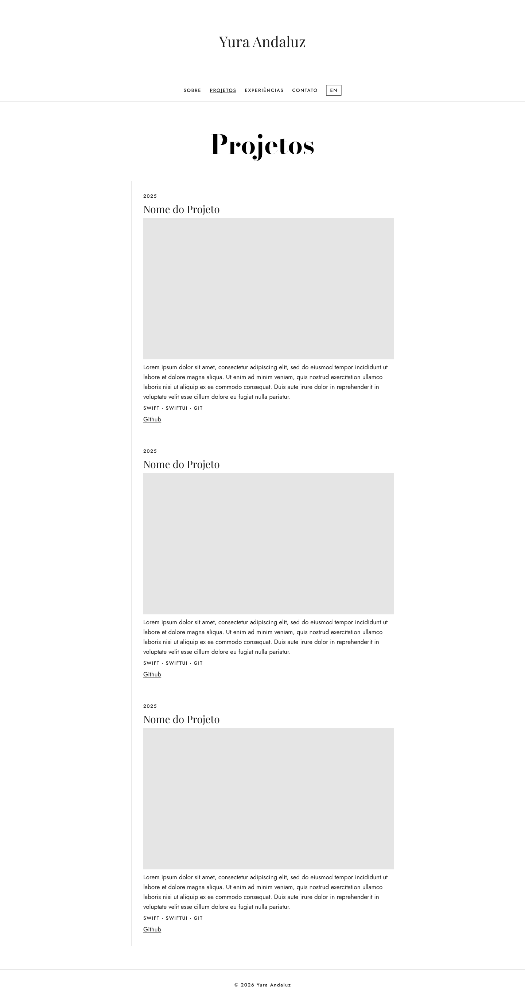
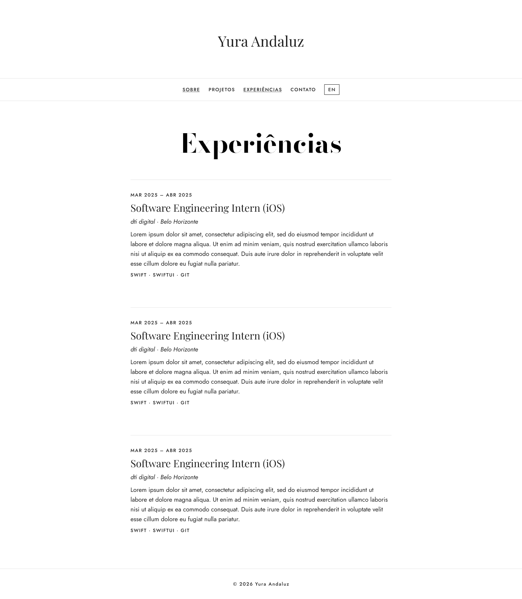
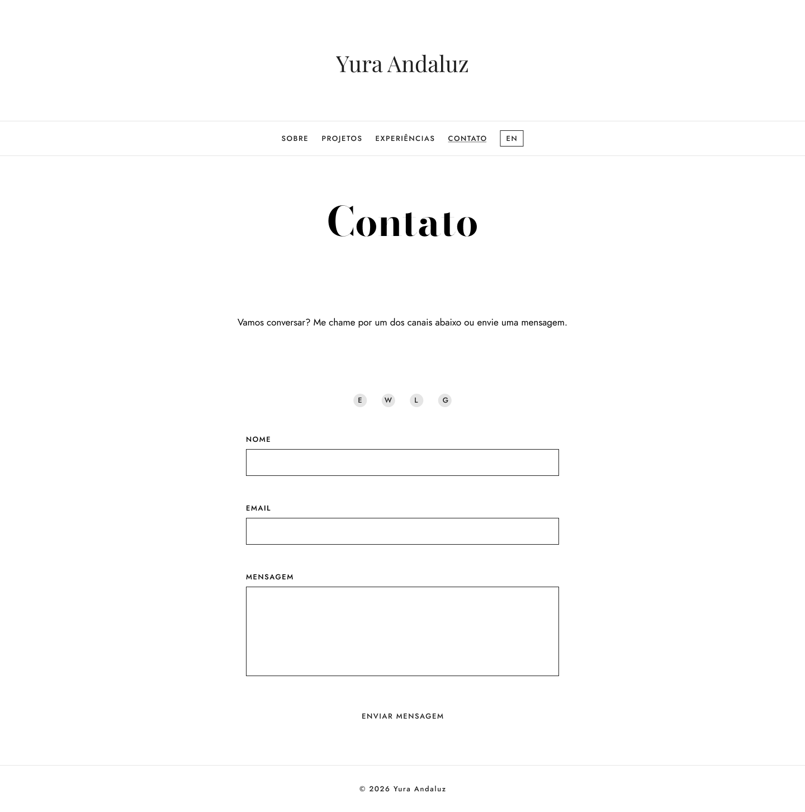
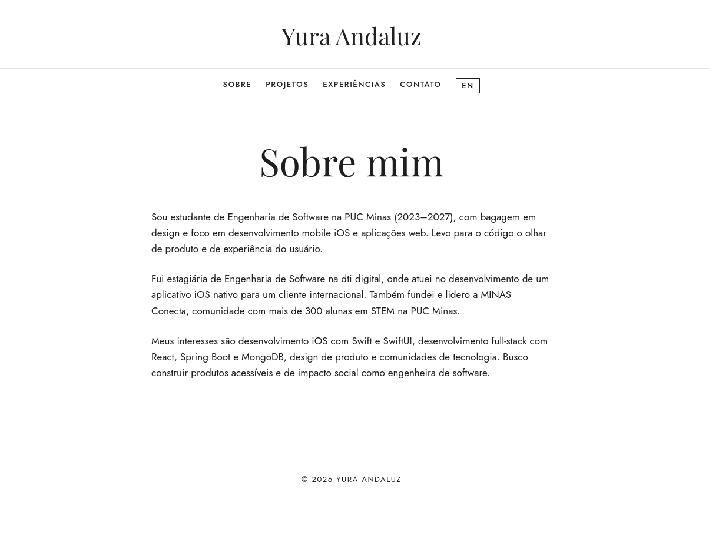
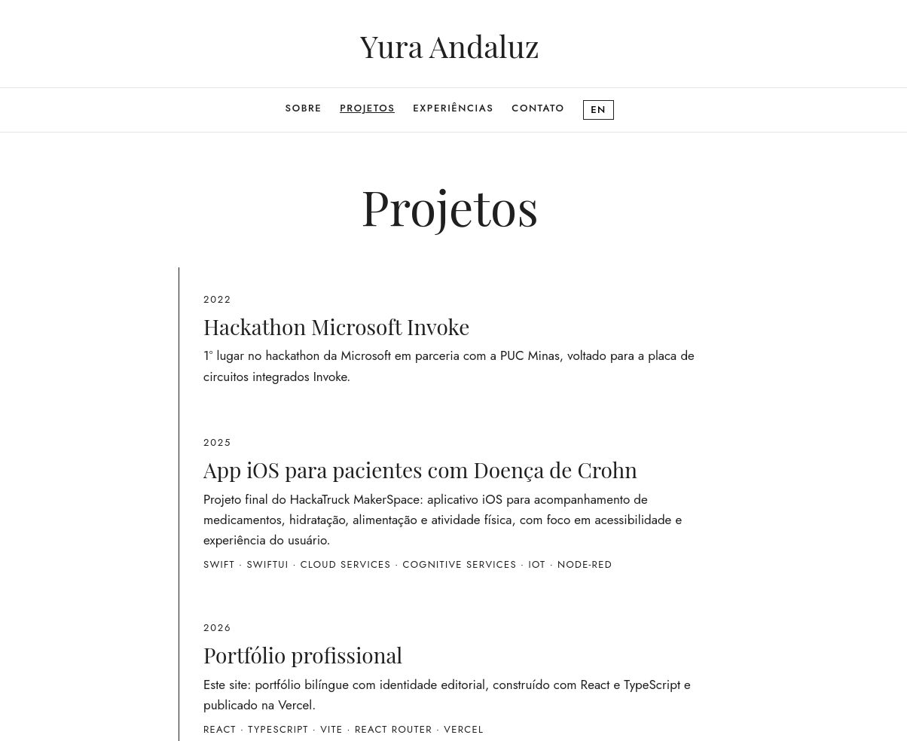
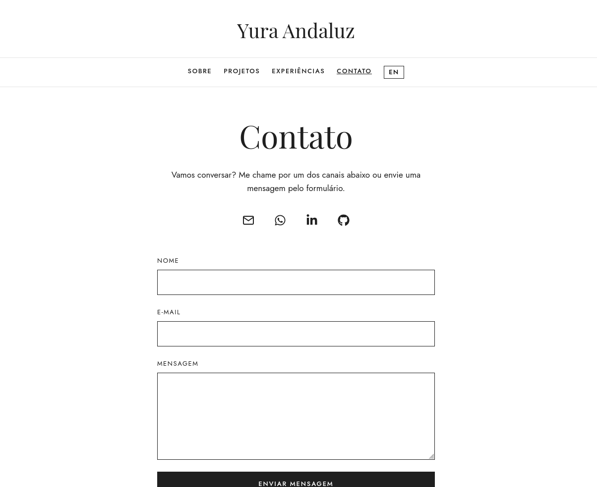

<!-- README — Lab 01 (DIAW, PUC Minas). Estrutura baseada no template do Prof. João Paulo Aramuni, com identidade visual própria.
     Trechos marcados com «TODO» precisam ser preenchidos antes da entrega. -->

<div align="center">

<br>

<sub>P O R T F Ó L I O &nbsp; P R O F I S S I O N A L</sub>

# Yura Andaluz

<sub>ENGENHARIA DE SOFTWARE &nbsp;·&nbsp; DESENVOLVIMENTO iOS E WEB &nbsp;·&nbsp; DESIGN</sub>

<br>

*Uma edição bilíngue sobre trajetória, projetos e contato.*

<br>

[**Site**](https://yuraandaluz.vercel.app/) &nbsp;·&nbsp; [**Figma**](https://www.figma.com/design/yfhwZ2MOWHqt6sQZstJg3A/Portfolio?node-id=2-2&t=pJOBIEO9VZdHT7zp-1) &nbsp;·&nbsp; [**Repositório**](https://github.com/yuracandaluz/portfolio)

<br>


<br>

<sub>Laboratório 01 &nbsp;·&nbsp; Desenvolvimento e Integração de Aplicações Web &nbsp;·&nbsp; PUC Minas</sub>

</div>

<!-- TODO: criar um monograma na sua identidade visual e colocar no topo, dentro do <div align="center"> -->

---

### Nesta edição

| Nº | Seção | Nº | Seção |
| :-: | :-- | :-: | :-- |
| 01 | [Sobre o Projeto](#sobre-o-projeto) | 06 | [Deploy](#deploy) |
| 02 | [Funcionalidades](#funcionalidades) | 07 | [Estrutura de Pastas](#estrutura-de-pastas) |
| 03 | [Tecnologias Utilizadas](#tecnologias-utilizadas) | 08 | [Protótipos e Demonstração](#protótipos-e-demonstração) |
| 04 | [Arquitetura](#arquitetura) | 09 | [Documentações Utilizadas](#documentações-utilizadas) |
| 05 | [Instalação e Execução](#instalação-e-execução) | 10 | [Autora](#autora) |

---

<sub>Nº 01</sub>

## Sobre o Projeto

Este portfólio nasceu como o **Laboratório 01** da disciplina de Desenvolvimento e Integração de Aplicações Web (DIAW), do curso de Engenharia de Software da PUC Minas.

> Reunir em um só lugar quem eu sou, o que construí e como falar comigo.

|  |  |
| :-- | :-- |
| **Por que existe** | Apresentar minha trajetória de forma moderna e acessível, sem depender de um PDF. |
| **Problema que resolve** | Recrutadoras e colegas conhecem minha história e meus projetos em poucos cliques. |
| **Contexto** | Acadêmico e profissional. Une cerca de oito anos de design à formação em Engenharia de Software. |
| **Diferencial** | Identidade editorial, conteúdo bilíngue e formulário de contato funcional. |

<!-- TODO: reescrever esta seção na sua voz. É a parte que o professor lê primeiro. -->

---

<sub>Nº 02</sub>

## Funcionalidades

| | |
| :-- | :-- |
| **Navegação** | Menu com as quatro seções e destaque da página atual. |
| **Bilíngue** | Alternador PT/EN que traduz o site inteiro. |
| **Sobre Mim** | Formação, área de atuação, interesses e objetivos profissionais. |
| **Projetos** | Linha do tempo do mais antigo ao mais recente, com descrição, tecnologias e link do GitHub. |
| **Experiências** | Instituição, cargo ou atividade, período e descrição. |
| **Contato** | Ícones clicáveis (e-mail, WhatsApp, LinkedIn, GitHub) e formulário com envio por e-mail. |
| **Validações** | Campos obrigatórios, e-mail válido e tamanho mínimo da mensagem. |
| **Responsividade** | Layout adaptado a desktop e celular. |

---

<sub>Nº 03</sub>

## Tecnologias Utilizadas

| Camada | Tecnologia |
| :-- | :-- |
| **Interface** | React 19 · TypeScript |
| **Build** | Vite |
| **Navegação** | React Router |
| **Formulário** | React Hook Form · EmailJS |
| **Ícones** | React Icons |
| **Estilo** | CSS puro com variáveis (design tokens) |
| **Qualidade de código** | Oxlint |
| **Versionamento** | Git · GitHub |
| **Prototipação** | Figma |
| **Hospedagem** | Vercel |
| **Runtime e pacotes** | Node.js · npm |

### Dependências e bibliotecas

| Biblioteca | Função |
| :-- | :-- |
| `react`, `react-dom` | Interface por componentes |
| `react-router-dom` | Navegação entre páginas |
| `react-hook-form` | Formulário de contato e validações |
| `@emailjs/browser` | Envio de e-mail direto do front-end |
| `react-icons` | Ícones de contato |
| `typescript` | Tipagem estática |
| `vite` | Servidor de desenvolvimento e build |

<!-- TODO: conferir as versões exatas no package.json antes da entrega. -->

---

<sub>Nº 04</sub>

## Arquitetura

Uma **SPA (Single Page Application)** em React, sem back-end próprio nesta etapa.

- **Layout compartilhado.** `Header` e `Footer` aparecem em todas as páginas, e o conteúdo muda pelo `<Outlet />` do React Router.
- **Dados separados da interface.** Projetos e experiências vivem em `src/data` e são renderizados por componentes, sem repetir HTML.
- **Internacionalização por contexto.** O `LanguageContext` guarda o idioma, e cada texto é um objeto `{ pt, en }`.
- **E-mail pelo front-end.** O EmailJS envia a mensagem, com as chaves em variáveis de ambiente.
- **Rotas diretas na Vercel.** O `vercel.json` redireciona qualquer caminho para o `index.html`, e o React Router escolhe a página.

<!-- TODO: explicar em 2 ou 3 linhas por que você escolheu essa arquitetura (pergunta comum na apresentação final). -->

---

<sub>Nº 05</sub>

## Instalação e Execução

**Pré-requisitos:** Node.js LTS (18 ou superior), npm e Git.

### 1. Clonar e instalar

```bash
git clone git@github.com:yuracandaluz/portfolio.git
cd portfolio
npm install
```

### 2. Variáveis de ambiente

Crie um arquivo `.env.local` na raiz (ele **não** é versionado), seguindo o modelo do `.env.example`:

```
VITE_EMAILJS_SERVICE_ID=seu_service_id_aqui
VITE_EMAILJS_TEMPLATE_ID=seu_template_id_aqui
VITE_EMAILJS_PUBLIC_KEY=sua_public_key_aqui
```

> No Vite, as variáveis precisam começar com `VITE_` para chegar ao código do navegador.

### 3. Executar

```bash
npm run dev
```

O site abre em **http://localhost:5173**.

| Comando | Função |
| :-- | :-- |
| `npm run dev` | Servidor de desenvolvimento |
| `npm run build` | Versão final otimizada em `/dist` |
| `npm run preview` | Serve localmente a versão de produção |
| `npm run lint` | Verifica a qualidade do código |

---

<sub>Nº 06</sub>

## Deploy

Publicado na **Vercel**: [yuraandaluz.vercel.app](https://yuraandaluz.vercel.app/)

1. O repositório do GitHub está importado na Vercel, com o preset **Vite**.
2. As variáveis `VITE_EMAILJS_*` estão em *Project Settings → Environment Variables*.
3. A cada `push` na branch `main`, uma nova versão é publicada automaticamente.

---

<sub>Nº 07</sub>

## Estrutura de Pastas

```
.
├── docs/
│   └── images/             Wireframes (Figma) e prints do site
├── public/                 Arquivos estáticos
├── src/
│   ├── assets/             Imagens usadas pelo site
│   ├── components/         Header, Footer e Layout
│   ├── data/               Projetos e experiências
│   ├── i18n/               Contexto de idioma (PT/EN)
│   ├── pages/              About, Projects, Experience e Contact
│   ├── App.tsx             Rotas
│   ├── index.css           Estilos globais e design tokens
│   └── main.tsx            Ponto de entrada
├── .env.example            Modelo das variáveis de ambiente
├── index.html
├── LICENSE
├── package.json            Dependências e scripts
├── tsconfig.json
├── vercel.json             Redirecionamento de rotas na Vercel
├── vite.config.ts
└── README.md
```

---

<sub>Nº 08</sub>

## Protótipos e Demonstração

### Wireframes

Média fidelidade, no [Figma](https://www.figma.com/design/yfhwZ2MOWHqt6sQZstJg3A/Portfolio?node-id=2-2&t=pJOBIEO9VZdHT7zp-1).

| Sobre Mim | Projetos |
| :-: | :-: |
|  |  |
| **Experiências** | **Contato** |
|  |  |

### O site no ar

| Sobre Mim | Projetos |
| :-: | :-: |
|  |  |
| **Experiências** | **Contato** |
|  |  |

<!-- TODO (Sprint 03): adicionar GIF do alternador PT/EN e do envio do formulário. -->

---

<sub>Nº 09</sub>

## Documentações Utilizadas

[React](https://react.dev/) &nbsp;·&nbsp; [Vite](https://vite.dev/guide/) &nbsp;·&nbsp; [TypeScript](https://www.typescriptlang.org/docs/) &nbsp;·&nbsp; [React Router](https://reactrouter.com/) &nbsp;·&nbsp; [React Hook Form](https://react-hook-form.com/) &nbsp;·&nbsp; [EmailJS](https://www.emailjs.com/docs/) &nbsp;·&nbsp; [Vercel](https://vercel.com/docs) &nbsp;·&nbsp; [Conventional Commits](https://www.conventionalcommits.org/en/v1.0.0/)

---

<sub>Nº 10</sub>

## Autora

<div align="center">

**Yura Andaluz**

<sub>Estudante de Engenharia de Software · PUC Minas · Belo Horizonte</sub>

[GitHub](https://github.com/yuracandaluz) &nbsp;·&nbsp; [LinkedIn](https://www.linkedin.com/in/yurajyanay/) &nbsp;·&nbsp; [E-mail](mailto:yurajyanay@gmail.com)

</div>

### Agradecimentos

Ao curso de [Engenharia de Software da PUC Minas](https://www.instagram.com/engsoftwarepucminas/), pelo apoio institucional, e ao [Prof. Dr. João Paulo Aramuni](https://github.com/joaopauloaramuni), pelos ensinamentos.

### Licença

Distribuído sob a **Licença Apache 2.0**. Veja o arquivo [LICENSE](LICENSE).

<br>

<div align="center">

<sub>© 2026 Yura Andaluz</sub>

</div>
